# Tarea 1
----
Abdiel Fernando José Otzoy Otzín
202300350


## 1. 🔹 Navegación de directorios

### `cd` (change directory)

-   **Función:** Permite cambiar de directorio dentro del sistema de archivos.
    
-   **Uso:**
    
    `cd nombre_directorio cd .. # Regresa al directorio padre  cd / # Va al directorio raíz  cd ~ # Va al directorio personal del usuario` 
    
-   **Ejemplo:**


----------

### `ls` (list)

-   **Función:** Lista los archivos y directorios dentro del directorio actual.
    
-   **Opciones útiles:**
    
    -   `ls -l` → Muestra en formato largo (permisos, propietario, tamaño, fecha).
        
    -   `ls -a` → Muestra también archivos ocultos (los que empiezan con `.`).
        
    -   `ls -lh` → Muestra tamaños legibles (KB, MB).
        
-   **Ejemplo:**

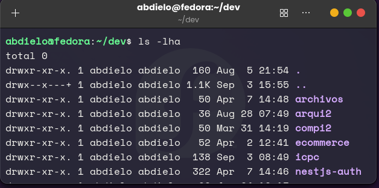

----------

### `pwd` (print working directory)

-   **Función:** Muestra la ruta absoluta del directorio actual.
    
-   **Ejemplo:**


----------

## 2. 🔹 Manipulación de archivos

### `touch`

-   **Función:** Crea un archivo vacío o actualiza la fecha de modificación si ya existe.
    
-   **Ejemplo:**

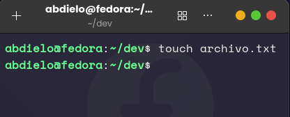

----------

### `cp` (copy)

-   **Función:** Copia archivos o directorios.
    
-   **Uso:**
    
    `cp archivo1 archivo2 cp archivo.txt /ruta/destino/ cp -r carpeta/ /ruta/destino/ # Copiar directorios recursivamente` 
    
-   **Ejemplo:**

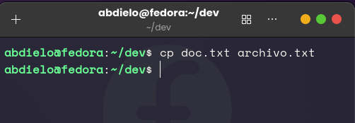

----------

### `mv` (move)

-   **Función:** Mueve o renombra archivos y directorios.
    
-   **Uso:**
    
    `mv archivo.txt /ruta/destino/ mv viejo_nombre.txt nuevo_nombre.txt` 
    
-   **Ejemplo:**

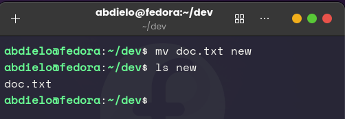

----------

### `rm` (remove)

-   **Función:** Elimina archivos o directorios.
    
-   **Uso:**

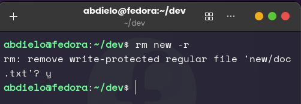

-   ⚠️ **Precaución:** Una vez borrado con `rm`, no se puede recuperar fácilmente.
    

----------

## 3. 🔹 Visualización de contenido

### `cat`

-   **Función:** Muestra el contenido completo de un archivo en la terminal.
    
-   **Ejemplo:**

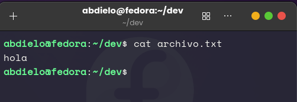

----------

### `more`

-   **Función:** Muestra el contenido de un archivo página por página (si es muy largo).
    
-   **Controles:**
    
    -   `Espacio` → Avanza una página.
        
    -   `q` → Salir.
        
-   **Ejemplo:**

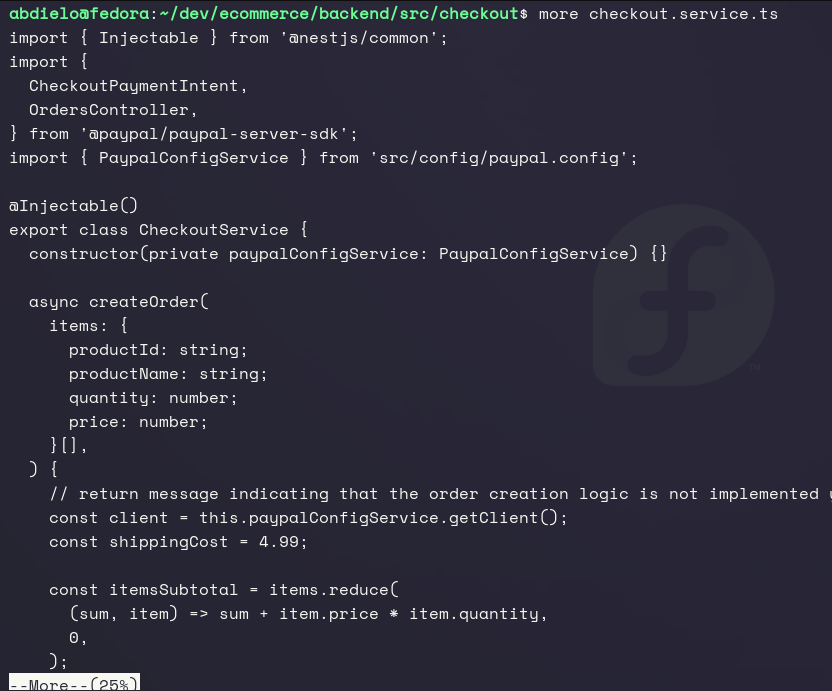

----------

### `less`

-   **Función:** Similar a `more`, pero más avanzado (permite navegar hacia arriba y abajo).
    
-   **Controles:**
    
    -   `Espacio` → Página siguiente.
        
    -   `b` → Página anterior.
        
    -   `q` → Salir.
        
-   **Ejemplo:**

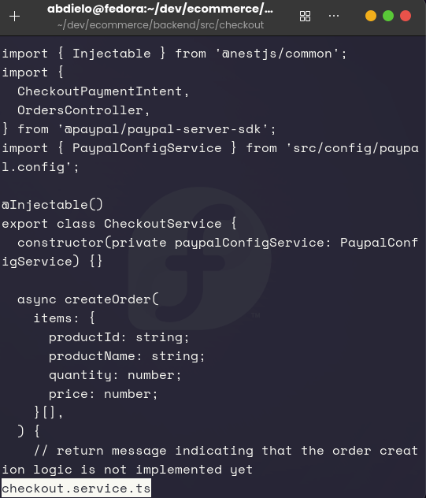

----------

## 4. 🔹 Gestión de permisos

### `chmod` (change mode)

-   **Función:** Cambia los permisos de un archivo o directorio.
    
-   **Modos de uso:**
    
    -   Numérico:
        
        -   `chmod 755 archivo`
            
            -   `7` = rwx (lectura, escritura, ejecución).
                
            -   `5` = r-x.
                
            -   `5` = r-x.
                
    -   Simbólico:
        
        -   `chmod u+x archivo` → Da permiso de ejecución al usuario.
            
        -   `chmod g-w archivo` → Quita permiso de escritura al grupo.
            
-   **Ejemplo:**

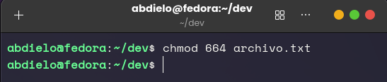

----------

### `chown` (change owner)

-   **Función:** Cambia el propietario o el grupo de un archivo/directorio.
    
-   **Uso:**
    
    `chown usuario archivo chown usuario:grupo archivo` 
    
-   **Ejemplo:**
    


## Desarrollo de un Script que simula la creación de contenedores

código del script `simular_crear_contenedores.sh`:

```bash
# Ruta del directorio donde está el script
RUTA_SCRIPT="$(dirname "$0")"

# Cantidad aleatoria de archivos entre 1 y 4
CANTIDAD=$(( RANDOM % 4 + 1 ))

echo "Creando $CANTIDAD contenedor(es) en la ruta: $RUTA_SCRIPT"

# Generar archivos
for (( i=1; i<=CANTIDAD; i++ ))
do
    # Generar un nombre aleatorio (usamos /dev/urandom para 6 letras)
    NOMBRE_ALEATORIO=$(cat /dev/urandom | tr -dc 'a-zA-Z' | head -c 6)

    # Nombre del archivo
    ARCHIVO="contenedor_202300350_${NOMBRE_ALEATORIO}.txt"

    # Ruta completa
    RUTA_COMPLETA="$RUTA_SCRIPT/$ARCHIVO"

    # Crear archivo con su nombre como contenido
    echo "$ARCHIVO" > "$RUTA_COMPLETA"

    echo "Archivo creado: $ARCHIVO"
done

echo "Simulación completada ✅"
```

resultado de ejecutar el script:
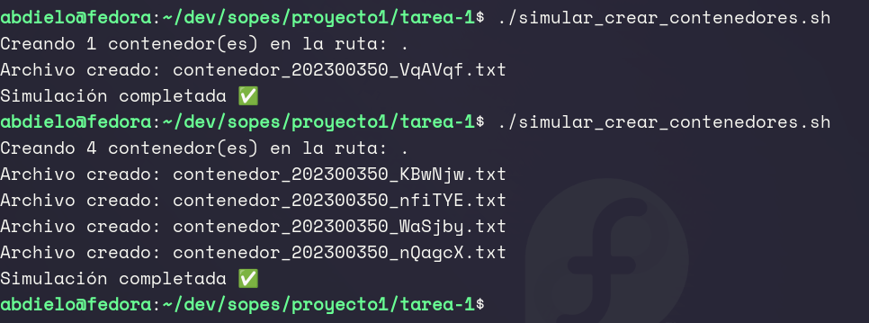

archivos generados:
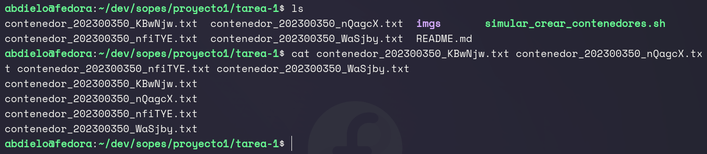